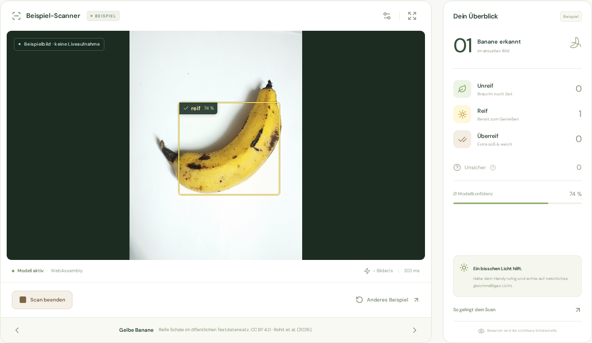
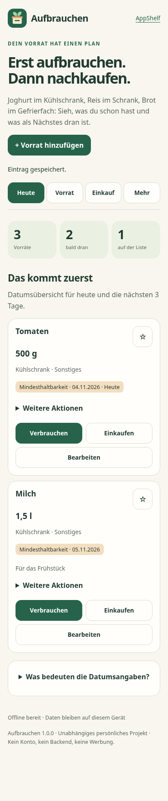
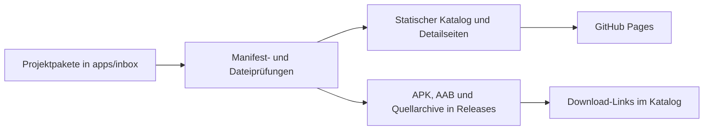

# AppShelf: Aus einzelnen Projekten wird ein gemeinsamer Katalog

[**Katalog ausprobieren ↗**](https://der-programmer1.github.io/AppShelf/) · [Quellcode](https://github.com/der-programmer1/AppShelf) · [Patrice / Lab](https://der-programmer1.github.io/patrice-lab/)

AppShelf ist mein öffentlicher Ort für Apps und Experimente. Die Idee: Wer ein Projekt entdeckt, soll schnell verstehen können, worum es geht, eine Vorschau sehen und die passende Demo oder Datei finden.

Für den technischen Blick ist AppShelf zugleich ein Beispiel dafür, wie sich aus strukturierten Projektpaketen eine geprüfte statische Website erzeugen lässt.

## Die Aufgabe

Einzelne Projekte bringen unterschiedliche Inhalte mit: eine Browser-Demo, Android-Dateien, Quellarchive oder einen extern gehosteten Prototyp. AppShelf führt sie in einer gemeinsamen Darstellung zusammen. Screenshots, Versionsangaben, Downloads und Links stammen aus den jeweiligen Projektpaketen.

Der öffentliche Katalog ist die Besucherseite. Das Repository zeigt, wie diese Darstellung entsteht.

## Einblicke in die Projekte

| Bananenblick · öffentlicher Prototyp | Aufbrauchen · Web-Ansicht |
| --- | --- |
|  |  |
| [Öffentlichen Prototyp ansehen](https://der-programmer1.github.io/Bananenblick/) | [Projekt und Demo im Katalog](https://der-programmer1.github.io/AppShelf/apps/aufbrauchen/) |

Die Aufnahmen zeigen einzelne Projekte aus dem Katalog. Bananenblick verwendet hier ein Beispielbild; es ist keine Liveaufnahme. Die Herkunft des Bananen-Testbilds ist im [Bananenblick-Repository](https://github.com/der-programmer1/Bananenblick) dokumentiert: Rohit et al. (2026), CC BY 4.0.

## Wie aus einem Paket eine Website wird

Ein Projekt wird unter `apps/inbox/` mit einem `app.json`, einer Beschreibung, Screenshots und den jeweiligen Artefakten abgelegt. Die Build- und Veröffentlichungsabläufe lesen diese Daten, prüfen sie und erzeugen die öffentlichen Seiten.

Die Trennung ist praktisch: Die Darstellung wird gemeinsam erzeugt, während jede App ihre eigene Technik und ihren eigenen Entwicklungsstand behält.

## Vier Entscheidungen hinter AppShelf

| Entscheidung | Wirkung |
| --- | --- |
| **Statisches HTML statt eines Katalog-Servers** | Der Katalog lässt sich über GitHub Pages ausliefern. Darstellung und Download-Steuerung funktionieren auch ohne JavaScript. |
| **Projektmanifeste als Grundlage** | Beschreibungen, Plattformen, Versionen und Verweise werden aus strukturierten Daten übernommen. |
| **App-Dateien in GitHub Releases** | APKs, AABs und Quellarchive bleiben als Downloads verfügbar, ohne den Pages-Output unnötig aufzublähen. |
| **Externe Apps über geprüfte HTTPS-Links einbinden** | Ein bereits veröffentlichtes Projekt kann im Katalog erscheinen, ohne eine zusätzliche App-Kopie zu betreiben. |

## Was daran technisch nachvollziehbar ist

- **Build und Automatisierung:** Node.js und GitHub Actions erzeugen und veröffentlichen den Katalog.
- **Veröffentlichungsprüfungen:** Manifest-, Datei-, APK- und Quellarchivprüfungen bilden Teile des Veröffentlichungsvertrags ab. Browser- und Android-Prüfungen sind in den zugehörigen Workflows nachvollziehbar.
- **Darstellung:** Große Screenshot-Karten, Detailseiten und QR-Codes verbinden die Übersicht mit dem jeweiligen Projekt.
- **Versionsbezug:** Versionsangaben und veröffentlichte Dateien machen einen Projektstand überprüfbar.
- **Produktgrenzen:** Ein Katalogeintrag kennzeichnet den bestehenden App-Stand; er ersetzt keine Abnahme eines noch offenen Updates.

Die tatsächlichen Prüfergebnisse stehen in [GitHub Actions](https://github.com/der-programmer1/AppShelf/actions). Der [verifizierte Pages-Lauf vom 11. November 2026](https://github.com/der-programmer1/AppShelf/actions/runs/42974882388) gehört zum hier beschriebenen veröffentlichten Ausgangsstand. Daraus folgt keine pauschale Aussage über alle zukünftigen Änderungen oder über physische Smartphone-Tests.

## Eine konkrete Überarbeitung: Vorschauen zurückholen

Die Katalogkarten hatten ihre großen Screenshot-Flächen verloren. Die Überarbeitung in [PR #17](https://github.com/der-programmer1/AppShelf/pull/17) brachte die Bildvorschauen, abgerundeten Karten und Kategorie-Badges zurück. Bilder öffnen die Projektdetails; Hauptaktion und Optionsmenü bleiben zugänglich.

Im selben Schritt wurde die bereits öffentliche Bananenblick-Version 0.1.0 als Prototyp aufgenommen. Der Katalog verlinkt auf ihre bestehende Pages-Adresse. Das neue Update mit nummerierten Einzelbananen wurde dadurch nicht veröffentlicht.

## Was noch offen ist

Bananenblick entwickelt sich unabhängig vom AppShelf-Katalog weiter. Sein neues Büschel-Update hat die Modellziele noch nicht erreicht und benötigt weiterhin echte Geräteprüfungen. Ein grüner Software-Build allein gibt dieses Update nicht frei. [Zum aktuellen Entwurf →](https://github.com/der-programmer1/Bananenblick/pull/1)

AppShelf zeigt damit auch die unterschiedlichen Reifegrade von Projekten. Ein Experiment kann sichtbar sein, während seine Grenzen ausdrücklich dokumentiert bleiben.

## Selbst nachvollziehen

1. [Den Katalog öffnen](https://der-programmer1.github.io/AppShelf/) und eine Projektkarte erkunden.
2. Im Repository die Projektdateien unter [`apps/inbox/`](../apps/inbox/) ansehen.
3. Die [technische Anleitung](../README.md#technical-documentation) für Projektpakete, lokalen Build und Veröffentlichung lesen.
4. In [GitHub Actions](https://github.com/der-programmer1/AppShelf/actions) prüfen, welche Schritte auf welchem Stand tatsächlich ausgeführt wurden.

---

Projektvorstellung von Patrice. Entwicklung und Dokumentation erfolgen auch mit KI-Unterstützung. Die verlinkten Quellen und Prüfungen machen den beschriebenen Stand nachvollziehbar.
